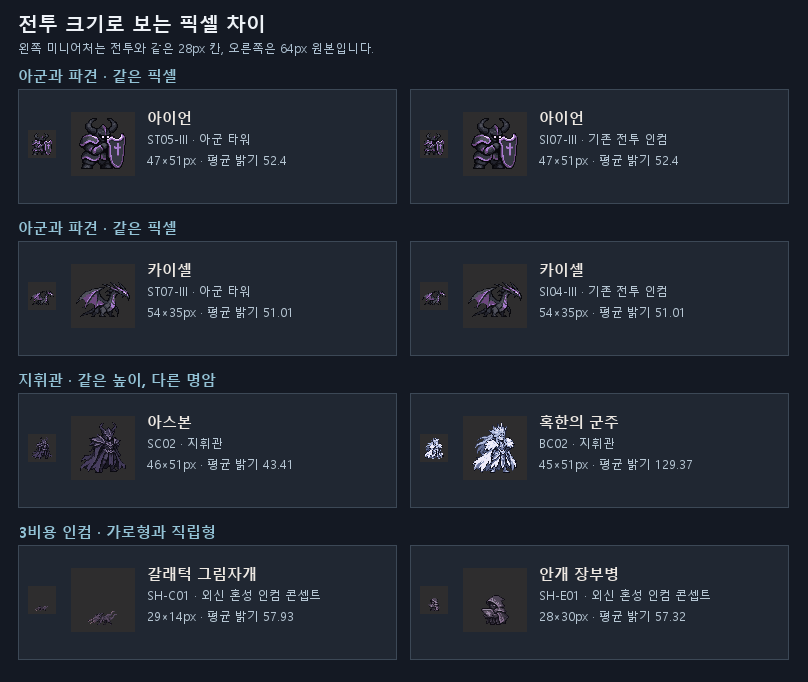

# 전투 스프라이트 픽셀 구성 비교

이 측정표와 28px 비교판은 보정 전 기준입니다. [적용한 보정과 개별 비교판](../unit-sprites.html#readability-pass)

**348개 항목을 전수 측정했습니다.** 현재 목록의 전투·광부 스프라이트 288장과 외신 혼성 인컴 콘셉트 60장입니다. 픽셀이 같은 항목을 묶으면 318종입니다. 전부 64×64px 투명 PNG이며, 불투명 색은 7–10색입니다. 외형을 가르는 차이는 **명암의 배치, 실루엣의 높이와 폭, 같은 픽셀의 재사용**에서 나왔습니다. [개별 측정값 CSV](../media/sprite-audit/sprites.csv) · [전투 크기 비교 PNG](../media/sprite-audit/battle-scale.png)

## 전체 비교

밝기와 치수는 스프라이트 한 장씩 측정한 뒤 분류별 중앙값을 구했습니다.

| 분류 | 장수 | 높이 | 캔버스 점유율 | 상자 채움률 | RGB 색 | 평균 밝기 | 외곽 밝기 |
| --- | ---: | ---: | ---: | ---: | ---: | ---: | ---: |
| 아군 타워 I–III | 90 | 45px | 26.6% | 58.5% | 10색 | 63.8 | 25.2 |
| 웨이브 적군 I–III | 84 | 36px | 21.0% | 50.4% | 10색 | 80.8 | 52.5 |
| 기존 전투 인컴 I–III | 90 | 45px | 27.4% | 59.4% | 10색 | 70.8 | 24.5 |
| 지휘관 | 15 | 51px | 31.9% | 57.0% | 10색 | 73.1 | 40.5 |
| 아군 광부 I–III | 9 | 39px | 31.5% | 63.0% | 10색 | 54.1 | 21.3 |
| 외신 혼성 인컴 콘셉트 | 60 | 30.5px | 18.2% | 64.2% | 10색 | 69.5 | 46.5 |

## 종류별로 읽히는 차이

### 아군 타워

- **어두운 외곽선과 내부 강조가 공통입니다.** 외곽 픽셀 중 밝기 48 이하인 비율의 중앙값은 92.4%입니다. 그림자는 평균 밝기 중앙값이 50.3이고 색수 중앙값이 8색입니다. 얼굴과 무기, 갑옷의 몇 면에 보라색 밝은 픽셀을 둡니다. 헌터는 밝기 76.0으로 얼굴·머리·천이 읽히며, 마수는 62.9로 털·갑각·돌의 재질 차이가 큽니다.
- **진화는 대체로 외형 덩어리를 키웁니다.** I·II·III의 캔버스 점유율 중앙값은 18.5% → 26.4% → 33.7%입니다. 30계통 중 29계통에서 점유 면적이 단계마다 늘어납니다. 예외인 카이셀 계통은 1,007 → 1,121 → 950픽셀로, III형이 날개를 가로로 펼치며 키가 42px에서 35px로 낮아집니다.
- 어두운 전장의 검은 표범 마수(BT02 I형)는 평균 밝기 37.6에 밝은 픽셀(168 이상)이 0개입니다. 용족 그림자(ST09 I형)는 44×21px로 가로 실루엣이 강하지만 28px 칸에 들어가면 실제 세로가 약 9px입니다. [아군 타워 90장 비교판](../media/sprite-audit/allies.png)

### 웨이브 적군

- **아군보다 작고 밝은 외곽이 넓게 드러납니다.** 높이 중앙값은 36px로 아군보다 9px 낮고, 외곽 평균 밝기는 52.5로 아군 25.2의 약 두 배입니다. 안개 몸통의 끝, 별가루 병기의 날과 결정, 혹한 게이트의 서리처럼 외곽 자체가 재질을 드러냅니다.
- **웨이브마다 밝은 재질이 다릅니다.** 별가루 병기는 금빛 결정, 혹한 게이트 군은 청회색과 흰 얼음, 심연 잔당은 탁한 적색·자주색이 두드러집니다. 밝기 범위는 적군 52.6–122.5, 아군 37.6–105.2로 겹칩니다. 갈래턱 사냥개 II형은 52.6까지 어둡고, 티엘의 투영 III형은 122.5까지 밝습니다.
- 진화별 점유율 중앙값은 16.5% → 21.5% → 27.0%입니다. 28계통 중 22계통에서 단계마다 면적이 늘어납니다. 등록 방향은 적군 84장 왼쪽, 아군 타워 90장 오른쪽입니다. [웨이브 적군 84장 비교판](../media/sprite-audit/enemies.png)

### 인컴 유닛

- **기존 전투 인컴은 아군 타워와 외형 구성이 가장 비슷합니다.** 높이 45px, 외곽 밝기 24.5로 아군의 45px, 25.2에 가깝습니다. 인컴 90장 중 30장이 아군 타워와 픽셀까지 같습니다. 현재 파견 덱 8장에서는 **카이셀과 아이언**이 아군 III형과 동일합니다. 이 둘은 전투에서 원본 스프라이트만 보면 소속을 읽을 수 없고, 시안은 별도의 체력바와 출현 표식으로 구별합니다.
- **외신 혼성 콘셉트는 저비용과 고비용의 실루엣 차이가 큽니다.** 바운딩 박스의 긴 변은 비용 3에서 28–30px, 비용 6에서 37–38px, 비용 9에서 47px, 비용 12에서 56px입니다. 점유율 중앙값은 7.5% → 17.7% → 26.2% → 38.8%입니다. 크기 구분이 긴 변과 면적 양쪽에 반영되어 있습니다.
- **같은 비용에서도 체형 차이가 큽니다.** 3비용 갈래턱 그림자개는 29×14px, 안개 장부병은 28×30px입니다. 전투형에는 창과 발톱을 옆으로 내민 실루엣이 많고, 이자형에는 등짐과 운반 장비가 세로로 두껍게 붙습니다. 사례의 갈래턱 그림자개는 28px 칸에서 세로 약 6px까지 줄어듭니다. [기존 전투 인컴 90장](../media/sprite-audit/income.png) · [외신 혼성 인컴 60장](../media/sprite-audit/hybrids.png)

### 지휘관과 광부

- **지휘관은 높이가 일정하고 명암이 캐릭터마다 다릅니다.** 15장 중 13장이 높이 51px이고, 벨리온은 폭 54px·높이 45px로 날개가 폭을 채웁니다. 아스본과 혹한의 군주는 모두 51px이지만, 평균 밝기는 각각 **43.4와 129.4**입니다. 아스본은 망토가 어두운 한 덩어리로 읽히고, 혹한의 군주는 얼음 갑주의 밝은 면이 먼저 보입니다. [지휘관 15장 비교판](../media/sprite-audit/support.png)
- **광부는 낮고 조밀합니다.** 높이 39px, 상자 채움률 63.0%, 외곽의 어두운 픽셀 중앙값은 98.8%입니다. 곡괭이·등짐·작업모처럼 직무를 읽는 픽셀이 중심이고, 제주도 개미 일꾼은 세 단계 모두 밝기 168 이상의 픽셀이 없습니다. [광부 9장 비교판](../media/sprite-audit/workers.png)

## 데이터 기준

- 현재 개별 PNG에서 알파 128 이상을 몸체로 계산했습니다. **캔버스 점유율**은 64×64 전체에서 몸체가 차지하는 비율이고, **상자 채움률**은 몸체를 둘러싼 가장 작은 사각형 안에서의 비율입니다.
- 밝기는 sRGB의 R·G·B를 가중 평균한 0–255 값입니다. 외곽은 상하좌우 중 투명 픽셀과 맞닿은 몸체 픽셀입니다. 348장 모두 알파가 0 또는 255입니다. 아래 투명 여백은 315장이 7px, 33장이 11px입니다. 11px 여백은 카이셀, 응집 안개, 등불 나방처럼 부유형으로 읽히는 계통에 집중됩니다.
- 방향 집계는 등록값을 사용했습니다. 기존 인컴·지휘관·광부 라이브러리는 방향 메타데이터가 비어 있고, 동일 스프라이트의 비교에는 투명 픽셀 아래 숨은 RGB를 정리한 뒤 RGBA를 대조했습니다.
- 수치는 기본 자세 스프라이트와 현재 인컴 콘셉트 PNG를 기준으로 합니다. 28px 비교판은 최근접 방식으로 축소해 작은 모바일 화면에서의 가독성을 확인했습니다. [측정 원본 목록](../media/unit-sprites/manifest.json) · [혼성 인컴 명세](../income-roster.json) · [측정 코드](../media/sprite-audit/source/measure.py) · [집계 JSON](../media/sprite-audit/summary.json)
