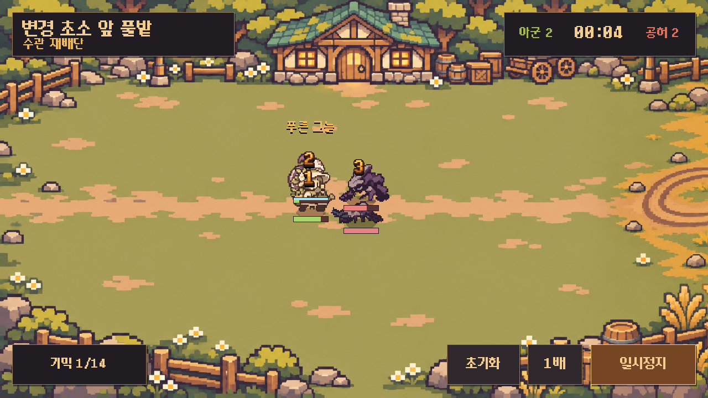

# Tavern Heros · 기믹별 플레이 QA

**역할 개편 전 Unity 빌드.** 14개 기믹을 일반·액티브 해제·일반 재실행·황금 편성으로 시험했다. 20Hz 전투에서 기물 조건·첫 시전·반복을 확인했다. [현재 3역할의 성장·출전 규칙](faction-mechanics.md)

**Unity → Tavern Heros → 기믹 QA 전투 씬 열기 → Play → 전투 시작.** 왼쪽 아래 **기믹 1/14** 또는 **3**으로 전환한다. **R** 초기화, **2** 속도 변경. **기믹 QA 전투 검증**에서 재현한다.

Windows 플레이어는 `E:/My project/Builds/Windows-FactionQA/TavernHeros.exe`다.

| 기믹 · 액티브 | 예상 플레이 흐름 | 확인한 판정 · 첫 발동 | 액티브 사용 / 해제 |
| --- | --- | --- | --- |
| 세계수의 축복 · 푸른 그늘 | 초반에 축복을 한 기물에 모아 이동·공격 보너스를 얻고, 계승자가 나오면 축복을 옮긴다. 재배사는 부상 아군과 3 이내를 유지한다. | 축복 6 이상에서 공격 증가. 부상 아군 1명 보호 · 4.85초 | 패 293 / 패 271틱 |
| 변신 · 갈퀴 휩쓸기 | 초반은 인간형으로 버티고, 적 둘 이상이 몰리는 전투에 동물형으로 출정한다. 변신을 받는 이웃과 배치를 맞춘다. | 동물형 출전 확정. 반경 안 적 2명 적중 · 4.75초 | 패 383 / 패 383틱 |
| 재련 · 불씨 산탄 | 초반 전투로 고철을 모아 임시 유닛을 내보낸 뒤, 임시 유닛과 맞붙은 적이 밀집하는 위치를 노린다. 산개하면 범위 피해가 줄어든다. | 고철 2 소비, 임시 편성 1기, 적 2명 적중 · 6.10초 | 패 513 / 패 513틱 |
| 강화 · 예비 장전 | 장기 기용할 주력에 골드를 투자한다. 정비공을 가까이 두어 추가 피해가 전열의 첫 교전에 들어가게 한다. | 2골드 소비, 장비 1단계로 주력 +1/+2. 장비 주력 1명에게 장전 · 3.65초 | 패 425 / 패 425틱 |
| 사냥 표식 · 표식 꿰기 | 초반에는 잡을 수 있는 적부터 골라 전리품을 쌓는다. 이후 정예를 노릴지, 빠르게 잡고 편성 성장을 이어 갈지 판단한다. | 원본 퇴장 후 전리품 1. 표식 주대상 피해 4 · 4.60초 | **무 600 / 패 557틱** |
| 추격 · 추격 신호 | 먼저 잡을 적 옆에 몰이대를 붙인다. 처치 관여 후 같은 기물의 유닛이 몰려 다음 적을 압박한다. | 첫 처치 관여 7틱. 같은 편성 1명 가속 · 1.35초 | 승 317 / 승 317틱 |
| 호위 · 방패 교대 | 전열 전체를 두껍게 하기보다 보호할 이웃을 지정한다. 첫 타격을 막고, 부상한 대상이 옆에 남으면 교대 보호막을 건다. | 지정 아군의 첫 피해 차단. 부상 아군 1명에게 교대 · 3.70초 | 패 315 / 패 293틱 |
| 응징 · 서약의 반격 | 감당할 수 있는 전열 손실을 정하고 집행관은 뒤에 둔다. 지정 전열이 모두 퇴장하면 남은 병력이 역공한다. | 아군 편성 최종 퇴장 후 자체 응징. 적 2명 적중 · 1.50초 | 패 183 / 패 183틱 |
| 생산 · 동력 분배 | 작업량을 로봇을 먼저 확보할 기물에 모은다. 조립기는 전열 뒤에서 자기 로봇과 3 이내를 유지한다. | 작업량 2로 영구 로봇 1기. 같은 기물 로봇 1기 가속 · 4.80초 | 패 491 / 패 491틱 |
| 과부하 · 축전 방전 | 쉬운 라운드는 충전을 모으고, 보호막이나 밀집 전열이 나올 때 켠다. 가까이 붙지 못하면 5초의 강화 시간을 잃는다. | 충전 2 소비. 활성화 중 적 2명을 공격 · 2.55초 | 패 427 / 패 427틱 |
| 보급 · 응급 약병 | 이번 선술집 첫 고용 순서로 수신자를 정한다. 신규 주력이 먼저 맞아도 약상인의 회복 거리 안에 남게 배치한다. | 신규 주력 출전 보급. 동일 주력 체력 3 회복 · 4.75초 | 패 388 / 패 344틱 |
| 호송 · 방패 견제 | 기존 주력 옆에 호송대를 배치한다. 두 유닛 가까이 들어온 공격자에 견제를 넣고, 4초의 기물 지원을 받는다. | 인접 지정과 4초 추가 평타. 적 1명 감속 · 4.75초 | 패 429 / 패 425틱 |
| 격노 · 분노 짓밟기 | 체력 피해를 받아도 오래 버틸 전열을 세운다. 격노 4 이후 밀집 적을 공격하고, 6 도달까지 전열을 유지한다. | 격노 6에서 정지. 짓밟기 1회, 적 2명 적중 · 4.85초 | 패 515 / 패 515틱 |
| 함성 · 후속 북소리 | 출전 전에 함성 주변에 강화할 기물을 모은다. 먼저 밀어붙인 뒤 6초 이후에도 수신 유닛이 곁에 남도록 배치한다. | 출전 함성 수신자에게 후속 공격력 부여 · 7.05초 | 패 403 / 패 403틱 |

## 판정과 범위

- 대표 편성은 효과가 보이는 시간을 확보하기 위해 일부 체력·공격력을 테스트용으로 조정했다. 종료 틱은 액티브에 따른 해당 전투의 차이를 뜻한다. 실제 1–15라운드 승률은 검증 전이다.
- 액티브 14종의 시전 길이, 황금 편성에서도 같은 액티브 사용, 네 가지 전투 1회 액티브의 중복 방지, 같은 입력의 이벤트 로그 일치를 확인했다. 축복 지급·이전, 장비 중복 결제, 생산 상한, 반인반수 출전당 성장, 고철 정산과 피해·보호막 적용 순서를 추가로 검사했다.
- 100대100에는 아군 276종의 프로필을 연결했다. 기획서에 개별 효과가 있는 154종에 효과 데이터를 연결했다. 같은 기물·형태에서 출전한 유닛끼리 소속 효과를 주고받으며, 장비·고철·충전처럼 선술집 상태가 필요한 스킬은 위 기믹 QA 전투에서 검사했다. 100대100의 세 편성은 각각 415틱 승리, 515틱 승리, 441틱 패배였다.
- 빠른 보행은 이동 +10%, 별도 범위가 명시되지 않은 일부 근접 회복·반격 판정은 1.8 월드 단위를 초기값으로 사용했다.
- 황금 사냥 기물이 부활을 기다리고, 소환물을 제외하며, 거리가 같을 때 왼쪽 슬롯을 두 번째로 지정하는지 확인했다. 두 정예 슬롯을 사냥해도 전리품을 총 3개로 제한한다.
- 등록한 일반 기물은 98장이다. 이번에 검증한 범위는 14개 기믹의 대표 효과다. 카드별 보조·황금 조합의 전수 검사, 대장 전용 기물 효과, 상점 UI에서 15라운드까지 이어지는 흐름은 남아 있다.

## Windows 캡처

1280×720에서 대표 기믹 14개의 첫 발동 틱이 코어 검증과 일치했다. 교전 중 스킬 이름이 피해 숫자와 겹치는 장면을 확인하고 스킬 이름을 위로 올렸다. 수정 후 1280×720의 푸른 그늘과 852×393의 표식 꿰기 화면을 확인했고, 표식 꿰기의 두 화면 크기에서 전투 로그가 일치했다. 원본은 Unity 프로젝트의 `Logs/NativeCapture/FactionQA-20261121/`에 있다.

100대100 편성 1을 1280×720, RTX 3070, Direct3D 12, 165Hz 수직동기화에서 실행했다. 전투 프레임 3,412개의 평균은 **164.5 FPS**, 95번째 백분위 프레임 시간은 **6.17ms**, 전투 코어의 95번째 백분위 처리 시간은 틱당 **4.91ms**였다. 원본은 `Logs/NativeCapture/FactionQA-Mass-20261121/`에 있다.

[기물·유닛 명단](faction-roster.md) · [액티브 발동 조건과 수치](unit-active-skills.md) · [100대100 Unity 전투](unity-battle.md)
