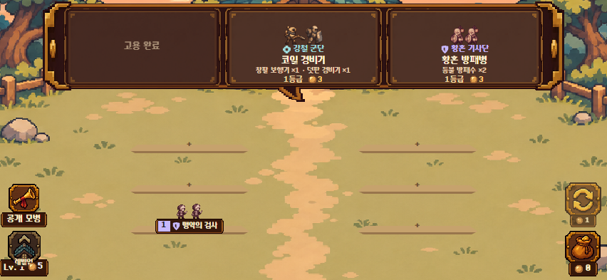

# Tavern Heros 가로 모바일 원정

## 1.0.5 · 크기를 유지하는 대기 대형

병종의 표시 크기는 병력 수에 따라 달라지지 않는다. 처음 고용한 병사는 명패 바로 위 앞줄 중앙에 서고, 증원병은 양옆과 뒷줄에 합류한다. 뒷줄은 한쪽으로 반 칸 엇갈려 서며 앞줄이 나중에 그려진다. [12명 증원 대형](../media/mobile-assembly/ranked-yard/reinforced.png) · [기물당 30명 배치](../media/mobile-assembly/ranked-yard/full-yard.png)

## 1.0.4 · 대기장의 병사

고용한 기물 위에 소속 병사가 한 명씩 서서 전투 병종의 대기 동작을 반복한다. 두 명을 고용한 뒤 첫 전투에서 신병 열 명을 받으면, 다음 대기장에는 같은 명패 위에 열두 명이 보인다. 같은 병종도 한 명으로 합쳐서 그리지 않는다. 한 기물에 30명이 차면 여러 줄로 서고, 기물을 옮기면 병사들도 함께 옮겨진다. 출정 때 받을 예정인 신병은 중복해서 미리 지급하지 않는다.

대기장 모델은 전투 병종 100종의 원본 대기 클립을 색면과 발 기준점으로 옮긴 2D 벡터 모델이다. 각 병사가 독립된 배치와 재생 시점을 가지며, 같은 병종은 네 자세의 지오메트리를 공유한다. [12명 대기 모션](../media/mobile-assembly/yard-actors/idle.gif) · [여섯 기물 180명 배치](../media/mobile-assembly/yard-actors/full-yard.png)

## 1.0.3 · 기물 능력 지정과 결과 화면

기물 상세에서 능력을 누른 뒤 대기장에서 강조된 유닛을 누르면 지정된다. 빈칸이나 메뉴를 누르면 새 지정을 취소하고 이전 예약을 유지한다. 적 표식과 생산 병종은 해당 유닛의 초상을 눌러 고른다. 황금 기물의 두 번째 대상은 다른 유닛을 누르거나, 첫 대상을 다시 눌러 한 곳만 지정할 수 있다. [황혼 방패병의 대상 지정](../media/mobile-assembly/direct-aim/aim.png)

전투 결과에는 상단 스테이지 번호, 승패, 현재 침식도 바와 **다음 스테이지** 버튼을 표시한다. 생존 병력과 다음 골드는 표시하지 않는다. 다음 선술집에 들어갈 때의 골드 지급 규칙은 같다. [스테이지 6 승리 · 침식도 16%](../media/mobile-assembly/direct-aim/result.png)

## 1.0.2 · 대기장과 고용 카드

대기장은 원본 시안의 앞마당, 여섯 배치 칸과 나무 명패를 사용한다. 상점의 **기물 이름은 표시한다**. 예를 들어 ‘묘목 돌봄이’ 카드에는 두 병사의 그림, ‘숲의 수호자’, ‘묘목 돌봄이’, ‘1단계’와 3골드가 보인다. ‘묘목 방패지기 2명’이라는 구성글은 카드 상세에서만 볼 수 있다. [대기장](../media/mobile-assembly/reference-yard/yard.png) · [상점](../media/mobile-assembly/reference-yard/shop.png)

## 1.0.1 · 유닛 외형, 전투 이펙트와 선술집 조작

**설치 파일:** `E:/My project/Builds/Android-Mobile/TavernHeros-1.0.1.apk` (140,953,188바이트). 기존 1.0과 같은 패키지·서명이며 버전 코드는 2다. APK 서명과 압축 무결성, 패키지에 들어간 상점 화면·원정 목록을 확인했다. 기존 앱을 삭제하지 않고 업데이트 설치할 수 있다.

진행 중인 98장 원정에도 새 병종의 외형과 동작을 적용한다. 원래 병사 ID와 능력, 배치, 전투 정산은 그대로 사용한다. 같은 이름의 새 기물은 지정된 고용 쌍으로 표시하고, 개편으로 이름이 바뀐 기물은 같은 계열·단계의 병종 외형으로 연결했다.

새 도트 이펙트는 발사·명중·치유·스킬 이벤트에서 재생한다. Unity 모바일 전투 씬에서 개울 정찰대의 이전 편성 2명과 새 편성 12명을 각각 출전시켜 동일한 전투 틱의 카메라 출력을 비교했다. [이전 저장 전투](../media/mobile-assembly/art-update/v1-fx-on.png) · [새 편성 전투](../media/mobile-assembly/art-update/v2-fx-on.png) · [같은 틱에서 이펙트만 끈 화면](../media/mobile-assembly/art-update/v2-fx-off.png)

상점 매대에는 초상·계열·단계·가격만 표시한다. 기물 이름과 병사 명단은 눌러서 확인한다. 지붕 아래에는 레벨업 문구와 현재 레벨·가격을 분리했고, 상세창의 **능력 사용**은 청록색, **판매**는 적갈색으로 표시한다. 이전 저장과 새 원정에서 808×360, 852×393, 1280×720 터치 에뮬레이션으로 고용 매대, 능력 창 열기, 판매와 레벨업 결제를 확인했다. [수정한 상점](../media/mobile-assembly/art-update/shop-v1.png) · [기물 상세 버튼](../media/mobile-assembly/art-update/actions-v2.png)

## 새 분대 원정 · 2026-11-24

선술집에서 고용한 **두 병사가 그대로 Unity 전장에 출전**한다. 15라운드 동안 분대가 커지며, 출정 때 새로 받은 병사는 다음 방문에도 남는다. 여섯 슬롯에 분대당 30명, 최대 180명이다. 새 원정은 일반·혼합팩 기물 104장과 선택한 대장의 전용 기물 3장을 원정의 계열·혼합팩·선술집 단계에 맞춰 진열한다. 대장 10명의 전용 기물을 모두 합한 전체 명단은 134장, 아군 병종은 100종이다.

- **첫 출정:** 기물을 고용하고 주머니를 닫은 뒤 출정한다. 기본 병사 2명과 공통 신병 10명이 출전하며, 계열이나 대장의 조건을 충족하면 병력이 더 늘어난다. 대기장에서 기물을 누르면 출정 예정 인원과 판정 등급을 확인할 수 있다.
- **다음 적:** 적 병종과 수량, 배치, 권능을 미리 본다. 15라운드의 다섯 후보는 서로 다른 보스 한 기를 포함해 164기로 시작한다. [2라운드 적 예고](../media/mobile-assembly/company-v2-forecast.png)
- **이전 저장:** 진행 중인 98장 원정은 기존 규칙으로 결과와 보상을 받고 끝낸다. 그다음 원정부터 새 편성을 사용한다. 대장 보유 목록은 공유한다.

**검증:** 실제 Unity 프로젝트의 C# 전투 코어로 적 75편성을 종료까지 실행하고, 기물 134장 각각의 두 병사 ID를 확인했다. 852×393 터치 에뮬레이션에서는 출정 요청을 같은 C# 코드로 정산해 결과 화면과 2라운드 재개까지 확인했다. 이는 Unity 렌더링이나 Android 기기 측정이 아니다. 병종별 세부 스킬 분기와 최종전 난도는 추가 대조가 필요하다.

**1.0 빌드 기록:** 첫 새 분대 원정 APK는 138,303,704바이트였다. Unity 6000.6.9f1에서 빌드하고 APK 서명(v2)과 압축 무결성을 확인했다. APK 안의 기물 134장·아군 100종·적 75편성 데이터 및 원정 스크립트가 빌드 원본과 일치했다. Android 8.0 이상, ARM64용이다. 최신 소스로 다시 빌드하려면 Workspace에서 `projects/rift-tavern/mobile/build-android.ps1`을 실행한다.

## 이전 배포본 · 원정 플레이

원정 종료 시 대장 팩 1개를 받는다. 홈의 **뽑기**에서 열면 새 대장 또는 중복 대장 조각 2개를 얻는다.

1. **시작 화면 → 홈.** 대장을 골라 원정을 시작한다.
2. **선술집 → 대기장.** 3골드로 고용한다. 설명·황금 효과를 보고 진형을 바꾸거나 기물을 끈다.
3. **출정.** 기물 한 장 이상이면 대기장 하단 가운데에서 Unity 전투를 시작한다. 첫 출정에 버튼 안내가 뜬다.
4. **결과.** 생존 수와 침식도를 확인한다. 침식도 100% 또는 15라운드 종료면 원정을 끝내고, 그 외에는 다음 선술집으로 간다. [침식과 골드 정산](run-rules.md)

선술집 앞마당에서 주인이 현재 고용할 수 있는 용병을 말풍선으로 소개한다. 아래 탁자에는 계열과 기물 이름, 등급과 고용 비용을 표시한다. 위쪽 내 덱의 명패에는 출전 순서, 계열 심볼과 기물 이름이 보인다. 명패를 누르면 해당 기물의 대기장 상세가 열린다. [선술집과 고용 후보](../media/mobile-assembly/tavern-recruits-852.png) · [대기장 명패](../media/mobile-assembly/yard-order-852.png)

상단의 **다음 적**을 누르면 이번 출정의 적 편성, 전열·후열과 좌우 위치, 역할, 공격력·체력, 권능과 적용 수치를 볼 수 있다. 대표 초상은 보스, 정예, 일반 순으로 표시한다. [다음 적 상세](../media/mobile-assembly/upcoming-enemy-852.png)

일반 기물 98종 중 뽑힌 다섯 계열이 등장한다. 적은 15라운드별로 후보 5개 중 하나를 고정한다. 원정 중 앱을 다시 열거나 홈으로 접근하면 준비·결과 화면으로 복귀한다. 종료 뒤 **새 원정**을 눌러 홈으로 간다. 타이틀·폰트·배경·기물 이미지는 앱에 포함한다.

선술집 레벨업은 1레벨 5골드부터 시작한다. 같은 레벨에서 라운드마다 1골드 할인하며 레벨업 후 새 기본 비용을 적용한다. 강화 시점이 없는 기존 2레벨 이상 저장은 복귀 라운드를 할인 기준으로 쓴다. [선술집 확장 규칙](run-rules.md#선술집-확장)

## Unity 에디터에서 실행

`Tavern Heros → 가로 모바일 원정 실행`을 누르면 에디터가 `MobileExpedition` 씬을 플레이하고 기본 브라우저에 시작화면을 띄운다. 브라우저에서 고용하고 출전하면 Unity의 Game 뷰에서 자동 전투가 진행된다. Unity에서 **결과 확인**을 누르면 브라우저가 결과 화면으로 이동한다. 이 경로로 실제 첫 전투를 실행해 결과 전달과 2라운드 골드 4 지급을 확인했다.

## BlueStacks 녹화에서 확인한 수정

- 43.67초 대기장에서는 강화 가격이 표시됐지만, 레벨 배지 위의 투명한 버튼이 강화 조작을 드러내지 않았다. 현재 가격을 표기하는 **강화** 버튼을 골드·레벨 옆에 표시한다.
- 71.30초 선술집의 기물에는 단일 스프라이트를 4프레임 시트로 읽는 문제가 있었다. 기존 착석 시트는 애니메이션을 재생하고, 착석 시트가 없는 기물은 원본 도트를 좌석에 맞춰 한 장으로 표시한다. [수정 전 녹화](../media/mobile-assembly/bluestacks-before-71s.jpg) · [수정 후 선술집](../media/mobile-assembly/seats-fixed-808.png)
- 대기장에서 기물을 고르면 조작 가능한 능력의 사용 버튼이 나타난다. 장비 강화, 충전 이전·과부하, 재련 증원, 축복 부여·계승, 변신, 호위·호송·응징 등의 대상 지정과 사냥 표식을 출정 전에 선택한다. 예약 비용은 골드·고철에 즉시 표시하고 취소 시 돌려준다. 출정할 때 Unity가 편성과 비용을 검증한다. 조건에 따라 발동하는 전투 효과는 자동으로 처리한다. [능력 선택 화면](../media/mobile-assembly/ability-fixed-808.png)

## 빌드와 검증

Android 설치 파일 경로는 `E:/My project/Builds/Android-Mobile/TavernHeros.apk`다. Workspace의 `projects/rift-tavern/mobile/build-android.ps1`로 웹 화면, 적 편성, 지형을 내보내고 Android 어댑터를 컴파일한 뒤 Unity 빌드를 실행한다. 기본값은 이 PC의 Unity 6000.6.9f1 설치와 `E:/My project`를 사용한다.

- Android APK에는 ARM64 Unity 전투 라이브러리, 기물 설명·용어 풀이, 첫 출정 안내가 포함된다.
- 출정할 때 홈 설정의 음악·효과음 값을 Unity에 각각 전달한다. 명중·방어와 스킬에 맞춰 효과음을 내고, 1–6·7–12·13–15라운드에 서로 다른 음악을 재생한다. [전투 사운드 듣기와 믹스 검증](../battle-audio.html)
- 새 APK에서 추출한 화면으로 808×360, 852×393, 1280×720에서 출정 위치, 첫 안내 표시, 다음 선술집 이동, 뒤로 가기 후 원정 복귀를 확인했다. Android 기기 설치는 별도로 남아 있다.
- 새 APK에서 추출한 화면을 852×393, 808×360, 1280×720 터치 에뮬레이션으로 확인했다. 실제 강화 결제와 테이블 증가, 능력 대상 지정·예약·취소, 화면을 다시 열었을 때의 예약 유지, 출정 명령을 검증했다. Unity에서는 지정한 보호막·장비와 재련 증원, 충전·축복 정산을 확인했다. 새 APK의 BlueStacks 재설치와 직접 플레이는 별도로 남아 있다.
- Unity에서 적 편성 75개를 실제 전투 로직으로 실행했다. 75개가 모두 종료됐고 마지막 라운드의 다섯 편성에서 보스 분열체가 각각 두 기씩 나왔다.
- APK에서 추출한 화면을 852×393, 808×360 터치 에뮬레이션에서 열어 시작화면 → 홈 → 고용 → 설명 → 진형·드래그 → 전투 요청 → 결과 → 다음 라운드까지 검증했다. 결과 화면 검증에는 Unity가 보내는 것과 같은 형식의 응답을 사용했다. 연결된 Android 기기가 없어 실제 앱 실행과 WebView에서 Unity로 넘어가는 구간의 기기 검증은 남아 있다.
- 선술집의 대장 액티브는 아래에 연결했다. 브린의 레벨업 할인과 미레의 심층 관측도 원정 상태를 읽는다. 대장 전투 패시브, 대장 전용 기물, 플레이어 경험치·특성의 원정 보상은 후속 범위다.

## 라운드 권능과 선술집

- 봉인·소용돌이·탐식·서리는 선술집에 적용한다. 나머지 열 가지는 Unity 전투에서 발동하며, 심해 파동은 피해 전에 위험 열을 표시한다.
- 유닛 스킬은 자동으로 발동한다. 기물 상세에 아군 액티브 이름을 표시한다. 재련 기물의 고용·판매 고철과 장비 기물의 첫 고용 보너스를 연결했다. 지정형 기물 효과는 대기장에서 예약한다. [적 스킬과 권능](enemy-character-design.md) · [아군 액티브](unit-active-skills.md)
- 일반 기물 98장의 일반·황금 효과를 고용·판매·입장·출정 준비에 연결했다. 영구 증원은 받는 기물에 남고, 제작 보호막과 같은 전투용 보너스는 해당 출정에만 적용한다. 적을 맞히거나 막은 기록은 Unity 결과에서 받아 다음 선술집에 정산한다. [기물별 효과](faction-roster.md) · [개별 효과 검증](../qa/individual-card-effects.mjs)
- Unity에서 일반·황금 편성 196개를 출전부터 전투 정산까지 실행했다. 브라우저에서 재련 대상 지정, 출전, 다음 선술집의 영구 증원 보존을 확인했다.
- 기물 설명은 일반·황금 모두 발동 조건과 결과를 짧게 적는다. 밑줄 친 용어나 유닛 스킬 이름을 누르면 카드 옆에 뜻이 열린다. 두 창이 나란히 들어가지 않는 미리보기는 설명을 아래에 배치한다.
- 선술집 상단의 **레벨업** 버튼으로 원정 골드를 결제한다. 상점에는 대장 팩 상품 세 가지를 진열한다. 계정별 최초 한 번 코인 1,000개, 다이아 200개, 대장 팩 5개를 지급한다. 구매한 팩은 뽑기에 쌓이며, 잔액과 보유량은 리로드 후에도 유지된다.

## 선술집 대장 능력

- 리롤 위의 아이콘은 출정 대장에 따라 바뀐다. 0.45초를 누르면 설명이 열리고 손을 떼면 닫힌다. 액티브는 0.45초 미만에 떼면 대상 선택을 시작한다. 손가락을 벗어나게 움직이거나 터치가 취소되면 종료한다. 키보드의 Enter와 Space도 같은 기준을 쓴다.
- 로언은 서로 다른 고용 후보 두 장을 제시한다. 고용하면 3골드와 3라운드 재사용 대기를 적용한다. 토린은 1골드로 고른 기물의 주력 공격력 +1, 최대 체력 +2를 다음 전투에 적용한다. 세라는 0골드로 미구매 탁자 하나의 제안을 바꾼다. 선택창을 닫으면 골드나 사용 횟수에 영향이 없다.
- 미레는 선술집에서 자신의 **심층 관측** 아이콘을 눌러 최대 세 라운드의 확정 편성과 권능을 본다. 아이콘은 대장별 투명 PNG 10장이다. [아이콘 제작 소스](../qa/render-captain-ability-icons.py) · [입력 검증 스크립트](../qa/captain-ability-input.mjs)
- APK에서 추출한 화면을 PC 마우스와 키보드, 852×393 및 808×360 가로 레이아웃과 터치 에뮬레이션에서 검증했다. 길게 누른 뒤 해제, 이동·취소, 재사용 제한, 취소 후 후보 유지, 3개 액티브의 확정과 골드, 토린의 Unity 주력 스탯 전달을 확인했다. [세라의 액티브 설명 화면](../media/mobile-assembly/captain-active-hold-852.png) · [에다의 패시브 설명 화면](../media/mobile-assembly/captain-passive-808.png)

[852×393 첫 출정 안내](../media/tutorial-reference/02-departure.png) · [852×393 전투 결과](../media/tutorial-reference/source/04-next.png) · [원정 이동 검증](../qa/expedition-navigation.mjs)
