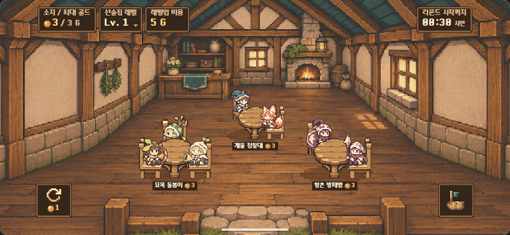
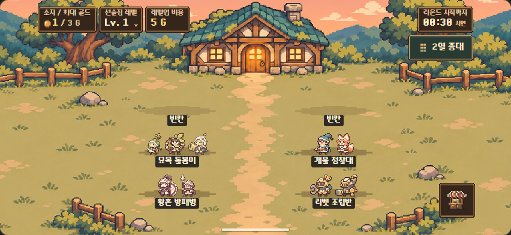

# 선술집 확장 일러스트와 인게임 UI 박스

선술집 1–5레벨과 대기장 공통 배경의 네 방향을 새로 그렸다. 기존 그림의 시점과 배치에 맞춰 중앙과 외곽을 한 장으로 보정했다. 가로 휴대폰과 PC는 주로 좌우 외곽을, 4:3 화면은 위아래의 지붕·하늘과 입구·흙길을 더 보여준다. [조작 가능한 가로 화면](../prep-landscape.html?phone=iphone16)

## 화면 미리보기

가로 모바일에서는 오른쪽 아래의 도트 아이콘이 이동할 화면을 표시한다. 깃발은 대기장, 가게는 선술집으로 연결된다. 선술집 왼쪽 아래에서 1골드로 리롤할 수 있고, 대기장의 오른쪽 위 배치 버튼으로 진형을 바꾼다.

- [Pixel 9 선술집](../media/preparation/responsive-v1/review/pixel9-tavern.png) · [Pixel 9 대기장](../media/preparation/responsive-v1/review/pixel9-yard.png)
- [가로 모바일 대기장의 2열 횡대와 기물 효과](../media/preparation/responsive-v1/review/iphone16-yard-line-detail.png)
- [4:3 선술집](../media/preparation/responsive-v1/review/tablet-tavern.png) · [4:3 대기장](../media/preparation/responsive-v1/review/tablet-yard.png)
- [목재 HUD와 양피지 설명창](../media/preparation/responsive-v1/review/iphone16-detail.png)
- [가로 모바일의 황금 효과 설명창](../media/preparation/responsive-v1/review/iphone16-golden-detail.png)
- [5레벨 선술집](../media/preparation/responsive-v1/review/iphone16-tavern-lv5.png) · [대기장과 5레벨 선술집의 이음새 수정 전후](../media/preparation/responsive-v1/review/edge-repair.png)
- [5레벨 선술집 오른쪽 전경 수정 전후](../media/preparation/responsive-v1/review/foreground-repair-lv5.png)

## 배경 원본

| 그림 | PNG 크기 | 기존 배치 기준 영역 `x, y, 너비, 높이` |
| --- | --- | --- |
| 선술집 [Lv. 1](../media/preparation/responsive-v1/tavern-1.png) · [Lv. 2](../media/preparation/responsive-v1/tavern-2.png) · [Lv. 3](../media/preparation/responsive-v1/tavern-3.png) · [Lv. 4](../media/preparation/responsive-v1/tavern-4.png) · [Lv. 5](../media/preparation/responsive-v1/tavern-5.png) | 704×352 | 160, 48, 384, 256 |
| [대기장 공통 배경](../media/preparation/responsive-v1/yard-1.png) | 1408×704 | 320, 96, 768, 512 |

화면 배치에서는 중앙 영역에 가로·세로 공통 배율을 적용한다. 고용 테이블과 대기 유닛을 중앙 영역에, 재화·타이머와 화면 전환 조작은 기기 안전 여백에 맞춘다. 대기장 레벨 2–5의 건물은 기존 현관 기준점에 겹친다. [편집 기준 좌표와 출처](../media/preparation/responsive-v1/manifest.json) · [생성 프롬프트](../media/preparation/responsive-v1/prompts.json)

## 9슬라이스 UI 박스

| 용도 | 텍스처 |
| --- | --- |
| 골드·레벨·시간, 기본 버튼 | [목재와 황동](../media/preparation/responsive-v1/panel-wood.png) |
| 선택된 화면과 버튼 강조 | [짙은 청록](../media/preparation/responsive-v1/panel-teal.png) |
| 기물 효과·소속 유닛 | [양피지](../media/preparation/responsive-v1/panel-paper.png) |

각 투명 PNG는 24×24픽셀이다. 상·하·좌·우 각각 6픽셀을 슬라이스 경계로 삼으면 박스 크기가 바뀔 때도 네 모서리의 크기가 유지된다. 현재 브라우저 준비 화면은 이 텍스처를 사용하며, 글자와 상호작용에는 기존 Cavern Text와 화면 조작을 사용한다. Unity 스프라이트에서 사용할 때에도 같은 6픽셀 경계를 지정한다.

## 확인한 화면

iPhone 16(852×393), Pixel 9(808×360), 태블릿 4:3(800×600), PC 16:9(1280×720), 390px 폭의 휴대폰 미리보기에서 배경이 화면을 채우는지 확인했다. 5개 레벨의 테이블 수, 대기장 전환과 진형 선택, 레벨별 건물, 설명창과 확장 PNG 다운로드를 검사했다. 대기장 오른쪽의 울타리·바위와 5레벨 선술집 왼쪽의 기둥·돌받침은 확대 비교로 확인했다.
