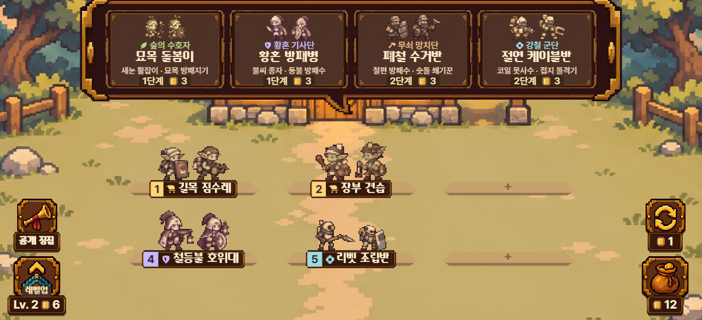
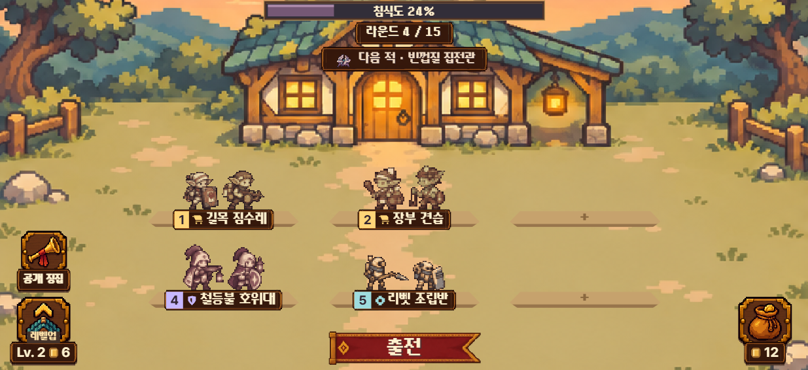

# 대기장에서 여는 선술집

오른쪽 아래 금화 주머니를 누르면 황동 테두리의 말풍선 상점이 화면 상단에 열린다. 네 고용 카드를 짙은 목재 진열판에 나란히 꽂고, 아래 대기장에는 여섯 배치 칸을 표시한다.

[버튼 시안 5종 전환하기](../media/ui-reference/shop-yard-concepts/index.html) · [버튼 원화 비교](../media/ui-reference/shop-yard-concepts/buttons.png) · [대기장과 상점의 화면 비교](../media/ui-reference/shop-yard-concepts/comparison.png)

## Android 원정에서의 조작

원정을 열면 대기장이 먼저 보인다. 오른쪽 아래 주머니로 상점을 열고 후보를 누르면 일반·황금 효과와 고용 버튼이 나온다. 진열 수는 선술집 레벨에 따라 3·4·4·5·6팀이다. 진열 중에도 아래 여섯 칸에서 분대의 능력을 확인하거나 기물을 끌어 옮길 수 있다. 주머니를 다시 누르면 상점이 닫히고 하단 중앙에 출정 버튼이 나타난다.

왼쪽 아래 지붕에는 **레벨업**, 바로 아래 나무 명패에는 **현재 레벨·비용**이 보인다. 고용 매대에는 두 병사의 그림, 계열, **기물 이름**, 단계와 가격을 표시한다. ‘묘목 방패지기 2명’처럼 병사 구성을 풀어 쓴 한 줄만 생략한다. 각 병사의 이름과 수는 기물 상세에서 확인할 수 있다.

[게임 화면 · 상점 열림](../media/mobile-assembly/reference-yard/shop.png) · [게임 화면 · 대기장](../media/mobile-assembly/reference-yard/yard.png)

## 상점 열림

[직접 열고 고용해 보기](../media/ui-reference/shop-popup-v3/index.html) · [세로 화면](../media/ui-reference/shop-popup-v3/shop-open-portrait.png) · [UI 소재 받기](../media/ui-reference/shop-popup-v3/hud-assets.zip)

| 위치 | 표기 순서 | 예시 |
| --- | --- | --- |
| 내 덱 | 카드 순서 · 계열 심볼 · 기물 이름 | 1 · 수레 심볼 · 길목 짐수레 |
| 상점 | 계열 → 기물 이름 → 기본 병사 두 명 → 단계와 고용 비용 | 무쇠 망치단 → 폐철 수거반 → 철편 방패수 · 숫돌 쐐기꾼 → 2단계 · 3골드 |

고용한 기물을 대기장에서 누르면 두 병사의 이름을 다시 볼 수 있다.

2레벨 선술집의 예시로 네 팀을 진열했다. 금화 주머니에는 현재 보유량만 표시하고 보유 상한은 두지 않는다. 상점이 열리면 주머니 바로 위에 1골드 리롤 버튼이 나타난다. 왼쪽 아래에는 레벨과 레벨업 비용, 바로 위에는 대장 능력을 둔다.

## 상점 닫힘

금화 주머니를 다시 누르거나 Esc를 누르면 상점이 접힌다. 상단 중앙에 침식도, 라운드, 다음 적이 차례로 보이고 하단 중앙의 붉은 버튼을 눌러 출전한다. 레벨업은 지붕과 위쪽 화살표, 로언의 공개 징집은 나팔로 구분한다.

시안 제작 자료

텍스트 명패와 고용 카드는 목재와 황동으로 마감한다. [카드와 명패 원화](../media/ui-reference/shop-popup-v3/counter-inlays-source.png) · [제작 기록](../media/ui-reference/shop-popup-v3/generation.json). 비교용 시안에는 2레벨 예시 편성을 넣었다. Android 게임의 고용과 리롤은 진행 중인 원정의 골드와 덱에 반영된다. [일반 기물 목록](faction-roster.md)

이전 배경 시안의 생성 프롬프트

Edit the supplied Tavern Heros screenshot into an unobstructed landscape game background plate, same warm sunset pixel art, same blue pitched-roof tavern in the upper center, upper edge trees, stone fences, grass meadow. Use EXACTLY the original 2.16:1 camera composition and tavern footprint, building entrance at about 50% x, 41% y. Clear the entire scene of HUD, text, numbers, buttons, units, nameplates, offer trays and formation platforms. The lower two thirds needs to be an open warm sandy olive training yard where the designer will typeset Korean HUD labels, add game sprites, and place shop UI later. Keep entrance recognizably a normal wooden door. No faces on the architecture, no bubbles, no speaker and no writing. One finished seamless pixel landscape. Keep illustrated assets crisp and clean.

