# Tavern Heros · Unity 전투

작업용 Unity 프로젝트는 `E:/My project`다. **Tavern Heros → 100대100 전투 씬 열기 → Play → 전투 시작**으로 전체 유닛 시뮬레이션을 연다. PC에서는 Space로 시작·일시정지·재개, 2로 속도 전환, 3으로 편성 전환, R로 초기화할 수 있다.

| 항목 | 경로 |
| --- | --- |
| 100대100 시작 씬 | `Assets/Scenes/Battle100v100-1.unity` |
| 100대100 Windows 빌드 | `Builds/Windows-100v100/TavernHeros.exe` |
| 전체 유닛과 수치 | `Assets/Data/Battle/mass-battle.json` |
| 첫 웨이브 씬 | `Assets/Scenes/BattleR01A.unity` |
| 첫 웨이브 데이터 | `Assets/Data/Battle/r01a.json` |
| 첫 웨이브 Windows 빌드 | `Builds/Windows-R01A/TavernHeros.exe` |
| 공허 스킬 훈련 씬 및 편성 | `Assets/Scenes/BattleEnemySkills.unity` · `Assets/Data/Battle/void-skills.json` |
| 공허 스킬 훈련 Windows 빌드 | `Builds/Windows-EnemySkills/TavernHeros.exe` |
| 첫 웨이브 플레이어 성장 Windows 빌드 | `Builds/Windows-R01A-Progression/TavernHeros.exe` |
| 전투 훈련 씬 | `Assets/Scenes/BattleTraining.unity` |
| 아군·적군 v9 원본 | `Assets/Art/AlliedMotion` |
| 유닛별 편집용 애니메이션과 프레임 목록 | 아군 `Assets/Animation/Allies/<unit-id>` · 적군 `Assets/Resources/EnemyMotion/<unit-id>` |
| 전투 코어 | `Packages/com.rifttavern.core/Runtime/Battle/AutoBattle.cs` |
| 훈련 편성과 연출 | `Assets/Scripts/BattleTraining.cs`, `Assets/Scripts/BattlePresentation.cs` |
| 검증 도구 | **Tavern Heros → 유닛 애니메이션과 전투 검증** |

## 100대100 전체 유닛 전투

한 전투에 서로 다른 아군 100종과 공허군 100기가 출전한다. 공허군은 매 편성에서 보스와 분열체를 포함한 32종을 한 번씩 내보내고, 일반 적을 더해 100기를 채운다. 전투 전후 화면 왼쪽 아래의 **편성 1/3** 버튼을 누르면 세 편성을 순환한다. 세 편성에 출전하는 아군 ID의 합집합은 276종이다. 기존 명단과 애니메이션, 도감의 공격력·체력을 사용하며 전투 코어에 연결된 역할과 스킬이 작동한다.

양 진영은 서로 겹치지 않는 10×10 배치에서 시작한다. 전장의 경계는 가로 27, 세로 16 월드 단위다. 유닛 중심과 몸체 반경 0.45를 함께 검사하므로 이동과 부활은 경계 안에서만 이뤄진다. 대규모 전투에 맞춰 캐릭터와 체력 막대 크기를 줄이고, 전장 전체가 화면에 들어오도록 배치를 조정했다.

Workspace 루트에서 아래 명령으로 Unity 프로젝트의 유닛 데이터를 갱신한다. Windows 플레이어는 **Tavern Heros → 100대100 전투 Windows 빌드**로 생성한다. 플레이어는 실행하면 편성 1을 연다.

```powershell
node workspace/2026-11-19_cavern-heros-25169da3/qa/export-mass-battle.mjs 'E:/My project'
node workspace/2026-11-19_cavern-heros-25169da3/qa/export-faction-runtime.mjs 'E:/My project'
```

유닛 효과를 반영한 100대100 세 편성의 전투 결과와 출전 기물·선술집 조건을 포함한 14개 기믹의 발동 기록은 [기믹별 플레이 QA](faction-playtest.md)에 정리했다.

유닛 효과 적용 후 세 편성에서 200기의 좌표를 매 틱 검사했고, 몸체 반경을 포함해 전장 경계를 벗어난 유닛은 없었다. 편성 1은 415틱, 편성 2는 515틱, 편성 3은 441틱에 종료됐다. 효과 적용 전에는 Windows의 1280×720, 852×393, 808×360에서 스프라이트 경계와 편성 1의 로그 일치를 검증했고, Unity 게임 뷰에서 편성 버튼으로 1→2→3→1 전환을 확인했다. 이 초기 캡처 원본은 `Logs/NativeCapture/MassRoster-20261121-153409/`에 있다.

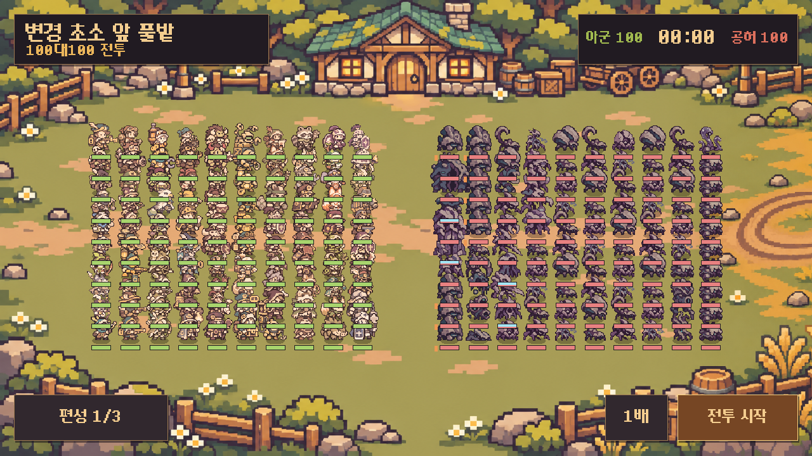

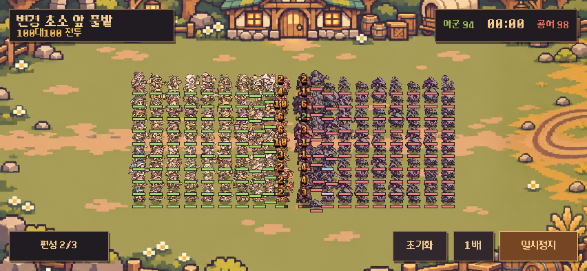

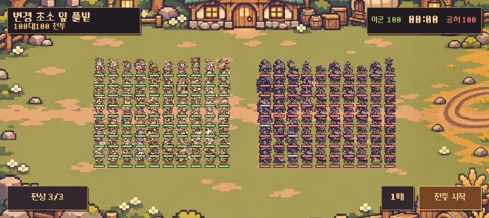

## 첫 웨이브 · R01A 첫 균열

R01A에서 전투를 마치면 플레이어 경험치와 레벨업 코인이 정산된다. 전투 전 왼쪽의 **특성**에서 해금된 특성 하나를 선택할 수 있다. [플레이어 레벨과 원정 특성](player-progression.md)

`r01` 변경 초소 앞 풀밭의 전장 경계와 출전 좌표를 사용한다. 적은 전열 중앙 `(0, -3.2)`의 틈새 추적자 한 기다. 공격력 2, 체력 2, 기본 근접 유닛이며 웨이브 권능은 없다. 선술집 편성이 연결되기 전까지 [아군 유닛 표](faction-roster.md)의 돌계단 종자 한 기를 공격력 2, 체력 3으로 아군 전열 중앙 `(0, 3.1)`에 배치한다. [전장 좌표 원본](../battle-maps.json) · [적 편성](enemy-waves.md) · [적 유닛 스탯](enemy-character-design.md)

Workspace 루트에서 아래 명령으로 기획 문서와 전장 JSON을 읽어 Unity 데이터를 다시 만든다. Unity에서 **Tavern Heros → R01A Windows 빌드**를 실행하면 첫 웨이브의 플레이어를 빌드한다.

```powershell
node workspace/2026-11-19_cavern-heros-25169da3/qa/enemy-wave-balance.mjs --export-r01a 'E:/My project/Assets/Data/Battle/r01a.json'
```

### R01A Windows 플레이어 검증

1280×720, 852×393, 808×360에서 시작 배치, 첫 타격, 승리 화면을 확인했다. 세 실행의 이벤트 CSV가 바이트 단위로 일치했다. 자동 캡처 원본과 CSV는 Unity 프로젝트의 `Logs/NativeCapture/R01A-20261121-130442/`에 있다. 가로 모바일 화면은 Windows 창으로 검증했으며, 실제 기기의 터치와 안전 영역은 검증이 남아 있다.

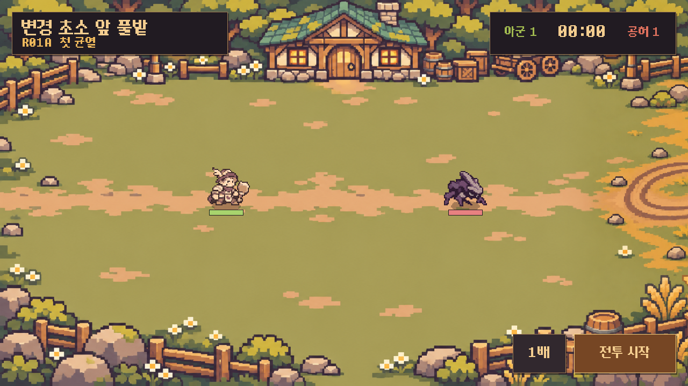

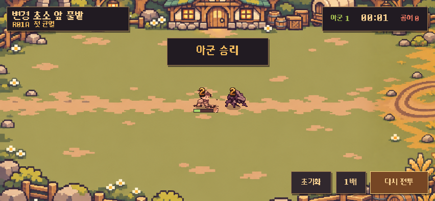

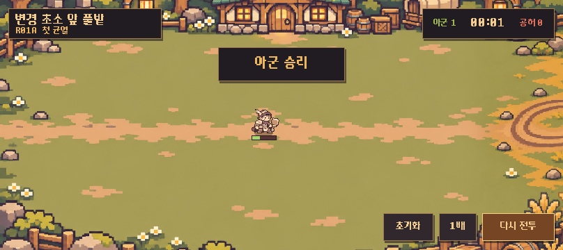

Workspace 브라우저 미리보기에서 1240px와 768px의 이미지 확대·다운로드·닫기를 확인했다. 390px에서는 상단 탭 바가 이미지 클릭을 가로막는 기존 문제가 재현됐다.

## 공허 스킬 훈련 · E01

**Tavern Heros → E01 공허 스킬 훈련 씬 열기 → Play → 전투 시작**으로 아군 5기와 실금 알껍질, 빈껍질 집전관이 교전한다. 알껍질은 첫 피해를 1 줄인다. 집전관은 4초에 다른 적이 살아 있고 체력을 잃었으면 최대 2 회복한다. 두 효과는 개별 전투 코어 테스트에서 수치와 발동 틱을 검증했다. [유닛 스탯과 스킬 조건](enemy-character-design.md)

## 아군·적군 애니메이션

v10은 양 진영 308종에 같은 프레임 재생기를 쓴다. 공허군의 공격과 스킬 자세 64개를 새로 가져왔으며 전체 클립 1,602개, 스프라이트 11,708개를 확인했다. Unity는 각 포즈의 작용점과 조준 방향, 스프라이트 배율을 읽어 실제 발사와 타격 이벤트에 맞춘다. [유닛 애니메이션 재생](../ally-animation.html) · [프레임 및 제작 규격](../sections/09-animation.md)

v9는 100대100 세 편성과 E01 Windows 전투를 종료까지 실행했다. 발사점 검수 씬에서 13틱에 표시된 방열 석궁수의 석궁과 투사체 출발점이 일치하는지 확인했다. 원본 캡처는 `Logs/NativeCapture/UnitMotion-v9/`에 있다. [Unity 발사 프레임](../media/unit-sprites/unit-motion-v9/review/native-source-release.png)

전투 코어는 근접 7틱에 타격, 원거리 9틱에 발사를 확정한다. Unity 재생기는 준비와 회복 구간을 각각 조절해 원본의 타격·발사 포즈가 그 틱에 오도록 맞춘다. 원거리 피해는 발사가 끝난 뒤 투사체 도착 틱에 적용한다. 원본 시트에 퇴장 동작이 없어, 훈련 씬은 마지막 피격 포즈를 활용해 퇴장을 표현한다.

Unity에서 1,602개 클립과 11,708프레임을 검증했다. v8 Windows 캡처는 100대100 세 편성, E01과 1번 기믹 전투의 대기 시작·정점에서 유닛의 월드 기준점이 일치하는지 확인했다. 각 전투를 종료까지 실행했다. 전체 캡처는 `Logs/NativeCapture/UnitMotion-v8/`에 있다. [Unity 대기 반복 캡처](../media/unit-sprites/unit-motion-v8/review/native-idle.gif) · [v7 석궁 단계별 캡처](../media/unit-sprites/unit-motion-v7/review/native-crossbow.png)

### v11 · 전투 이펙트

Unity 6000.6.9f1의 Windows 플레이어와 Direct3D 11에서 100대100 세 편성, R01A, E01, 기믹 전투의 푸른 그늘·불씨 산탄·축전 방전·응급 약병·분노 짓밟기를 확인했다. Windows 창을 1280×720, 852×393, 808×360으로 설정했다. 100대100 세 편성의 결과는 415·515·441틱에서 나왔고, 이전 버전과 전투 이벤트 CSV가 바이트 단위로 일치했다. 1280×720 편성 1에서 이펙트 켬·끔의 이벤트 파일도 일치했다.

전후 비교는 편성 1의 26틱과 60틱을 동일한 시점에서 캡처해 나란히 배치한 이미지다. 스킬 시트는 852×393 전투 창의 실제 발동 프레임이다. 원본 캡처와 이벤트 CSV는 Unity 프로젝트의 `Logs/NativeCapture/CombatFx-v11/`에 있다. [전후 비교](../media/combat-vfx/v11/native-comparison.png) · [스킬 발동 캡처](../media/combat-vfx/v11/native-skills.png) · [808×360 혼전](../media/combat-vfx/v11/native-808x360.png)

별도 프레임 측정은 RTX 3070의 1280×720 편성 1에서 수직 동기화와 프레임 제한을 풀고 실행했다. 10틱 이후 게임 루프 간격의 중앙값은 이펙트 끔 0.46ms, 켬 0.54ms였고, 95번째 백분위는 1.00ms와 1.14ms였다. 두 실행 모두 이벤트 1,722건이 일치했다. 실제 휴대폰의 GPU 비용은 측정 범위에 포함하지 않았다.

### v10 · 밀집 전투 이펙트 검증

Unity 6000.6.9f1의 Windows 플레이어를 Direct3D 11에서 실행해 100대100 세 편성을 종료까지 확인했다. 편성 1의 1280×720 캡처는 85틱에서 이펙트 켬·끔을 비교했으며 두 전투의 이벤트 로그가 일치했다. 808×360에선 편성 3을 확인했다. 세 편성에서 동시에 살아 있는 이펙트는 평타 최대 20개, 스킬과 패시브 최대 33개, 투사체 최대 23개였다. [켜기](../media/unit-sprites/unit-motion-v10/review/unity-100v100-on.png) · [끄기](../media/unit-sprites/unit-motion-v10/review/unity-100v100-off.png) · [808×360](../media/unit-sprites/unit-motion-v10/review/unity-100v100-wide.png)

E01에서 실금 알껍질의 경감을, 기믹 훈련에서 푸른 그늘·불씨 산탄·후속 북소리를 확인했다. 100대100의 빈껍질 집전관은 80틱에 동료를 회복했다. 현재 전투 코어에서 발동하는 스킬과 패시브는 실제 이벤트로 재생한다. 삼키는 자의 분열과 갈라진 예언자의 지정 열 타격은 브라우저에서 확인할 수 있다. [실금 알껍질](../media/unit-sprites/unit-motion-v10/review/unity-shell-guard.png) · [불씨 산탄](../media/unit-sprites/unit-motion-v10/review/unity-ember-scatter.png) · [이펙트 재생](../combat-vfx.html)

## 훈련 전투

교전은 20Hz로 진행한다. 근접은 도발과 전열을 우선하고, 원거리는 사거리에 도달하면 정지한다. 몸체가 겹치지 않도록 이동을 판정한다. 같은 틱에 확정된 타격을 함께 반영하고, 보호막이 먼저 피해를 받는다. 장막 유령은 첫 퇴장 8틱 뒤 체력 1로 돌아온다. 늑대 투창수의 **표식 꿰기**와 협곡 북대장의 **후속 북소리**가 조건에 따라 자동 발동한다. HUD와 버튼은 Cavern Text, 피해 수치는 Cavern Impact로 그린다. [전투 AI 설계](combat-ai.md) · [게임 이미지 폰트](bitmap-fonts.md)

훈련전은 장애물이 없는 풀밭과 전투 동작을 검증하기 위한 고정 4대4 편성을 사용한다. 적은 기존 스프라이트에 이동·돌진·피격 연출을 적용했다. 장애물 경로 탐색, 나머지 웨이브와 액티브·기믹, 선술집·홈의 런 흐름은 이후 연결 범위다.

## 기존 100대100 부하 시험

기존 훈련 유닛 아군 4종과 적군 4종을 진영별 20열×5줄에 반복 배치했다. 유닛 200기의 충돌·조준·공격·스킬을 1배속 20Hz 전투 코어로 판정하고, Windows 플레이어의 기존 스프라이트·투사체·HUD를 렌더링했다. Unity 6000.6.9f1, Direct3D 12, Ultra 품질, 1280×720 창 모드에서 측정했다. PC는 Core i5-13600K와 GeForce RTX 3070, 화면은 165Hz다.

| 실행 | 전체 평균 FPS | 첫 5초 평균 FPS | 하위 1% FPS | 프레임 시간 p99 | 최장 프레임 |
| --- | ---: | ---: | ---: | ---: | ---: |
| 기본 설정 · 수직동기화 | 165.0 | 165.2 | 138.1 | 6.67ms | 12.43ms |
| 제한 해제 · 1회차 | 1,119.8 | 672.3 | 245.7 | 2.60ms | 10.41ms |
| 제한 해제 · 2회차 | 1,208.1 | 742.8 | 279.2 | 1.87ms | 9.39ms |

세 실행에서 16.67ms를 넘는 프레임은 없었다. 하위 1% FPS는 가장 느린 1% 프레임의 평균 시간을 FPS로 환산했다. 제한 해제 수치는 엔진의 프레임 간격을 바탕으로 계산했으며, 전체 평균에는 생존 유닛이 줄어든 후반도 포함된다. 전투 코어의 틱 처리 시간은 실행별 평균 1.63~1.70ms, 최장 7.80ms였다.

600틱(30초) 제한에 아군 42기, 적군 3기가 살아 있어 무승부로 끝났다. 세 프레임 측정과 별도 캡처의 전투 이벤트 3,979건은 모두 일치했다. 기존 카메라와 HUD에서 양 끝 유닛 일부가 화면 밖으로 잘리고, 밀집 교전에서는 체력 막대와 피해 수치가 겹쳤다. 원본 프레임 CSV, 전투 CSV 및 캡처는 Unity 프로젝트의 `Logs/NativeCapture/100v100-20261121-131754/`에 있다.

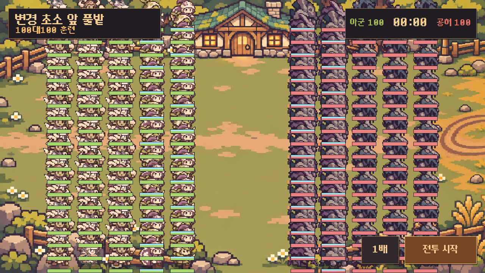

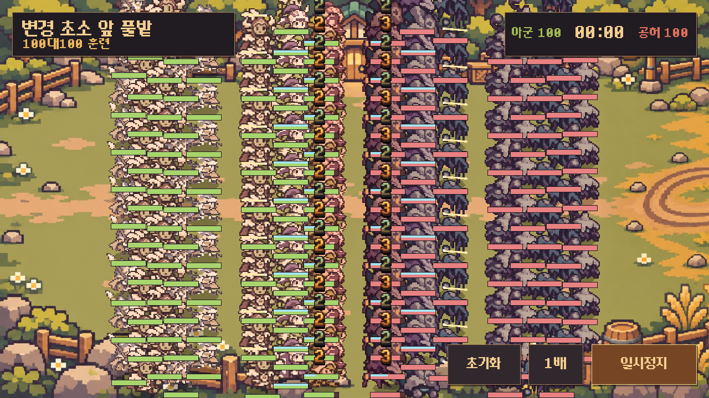

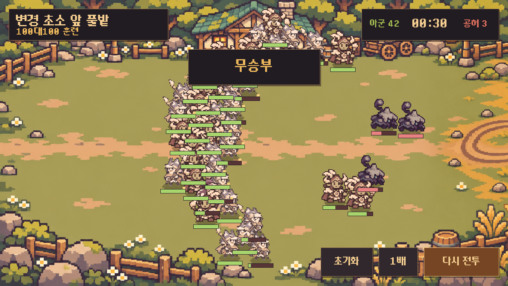

측정은 당시 훈련용 8종을 반복 배치한 편성으로 진행했다. 현재 전체 유닛 편성의 자동 측정은 플레이어 실행 시 `--measure-battle <결과 폴더>`를 사용한다. `--uncapped`를 함께 붙이면 수직동기화와 FPS 제한을 해제한다.

## 검증

Unity 6000.6.9f1에서 가져온 프레임과 마커를 전수 대조했다. 훈련 전투는 반복 실행에서 같은 기록 136건으로 255틱(12.75초)에 아군이 이겼다. 후속 북소리 129틱, 표식 꿰기 161틱, 부활 166틱을 확인했다. 시작 자세에서 선행 피해가 발생하지 않는지, 같은 틱의 쌍방 타격, 발사 전 취소, 원거리 착탄 시간, 도발 우선순위, 종료 제한 600틱도 검사했다.

Unity Game 뷰에서 훈련전 시작, 일시정지, 재개, 1배·2배 전환과 초기화를 확인했다. 스크립트 리로드 직후 늑대 투창수의 발사 타이밍이 0ms로 남던 오류를 수정하고, 276종의 338개 공격 마커와 8개 후속 마커를 다시 검증했다. `R01A`는 검증을 두 번 실행해 같은 이벤트 6건을 얻었다. 쌍방이 2씩 피해를 주고 24틱(1.20초)에 돌계단 종자가 체력 1로 이겼다.

### Unity 플레이어 캡처

동일한 빌드의 전투를 PC 1280×720과 휴대폰 가로 비율 852×393, 808×360에 각각 띄웠다. 세 실행의 전투 기록 SHA-256이 일치했다. 휴대폰 비율 검증은 Windows 플레이어의 창 크기를 바꿔 확인했다.

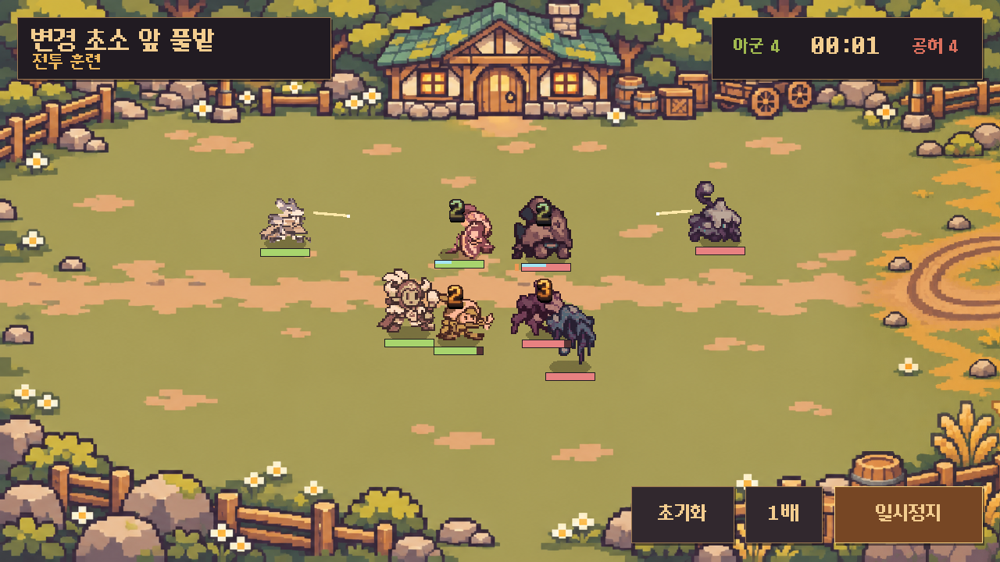

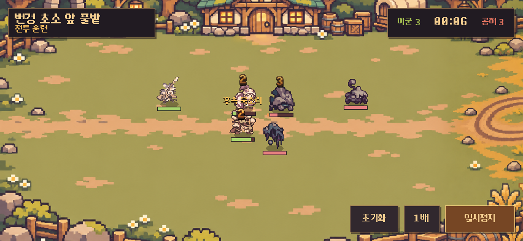

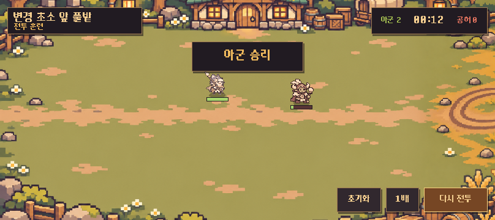
